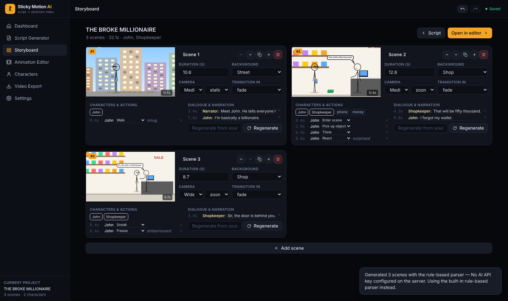

# Sticky Motion AI

Turn a text prompt or a full script into an animated stickman video — with real keyframe animation, spoken dialogue, camera direction, subtitles, synthesized sound effects, and genuine MP4/WebM export. Everything runs on your own machine: no API keys, no accounts, no internet connection.



## Quick start

```bash
npm install
npm run voices     # once: downloads the natural voices (~205 MB), then everything runs offline
npm run dev        # starts the local server (:8787) + Vite dev server (:5173)
# open http://localhost:5173
```

Production build:

```bash
npm run build
npm start          # serves the built app on http://localhost:8787
```

The script parser, the animation engine, the voices, the sound effects and the music are all built into the code.

If `ffmpeg` is installed on the machine, MP4 conversion runs through it (fast). Otherwise MP4s are encoded in the browser with ffmpeg.wasm (`npm install` copies the core into `public/ffmpeg/`).

### Natural voices

`npm run voices` downloads three [Piper](https://github.com/rhasspy/piper) neural voice models into `voices/` (one of them holds many speakers). Speech is then generated on this computer in a background worker, about four times faster than real time. When you generate a script, every line is voiced and each scene is timed to the real speech. New characters get clearly different voices, and the narrator gets a steady narration voice. You can change any character's voice in the inspector, and their lines are re-recorded. Without the models the app falls back to the built-in robotic voice. You can also record your own voice per line.

## Writing a script

```
TITLE: My video

SCENE 1: The park
Anna walks into the park and waves at Bob.

BOB: "You are late."

ANNA
(nervously)
I lost the map.

"Not again," says Bob.
(Bob facepalms)
THE END
```

- Scene headers: `SCENE 1:`, `SCENE 2: The shop`, `INT.` / `EXT.`, or `# Title`.
- Dialogue: `NAME: "line"`, a `NAME` alone on a line with the line below it, `John says "…"`, or `"…" says John`. `NARRATOR:` lines become narration.
- Actions: short sentences with a character and a verb the engine can animate (walk, run, enter, leave, sit, jump, wave, point, laugh, cry, slip, fall, fight, hug, pick up, think, read, celebrate…). Stage directions in brackets work too.
- Sentences the parser cannot turn into anything are listed after generating (Script Generator → “Last generation”), so nothing is skipped silently.

## Testing the full script → animation workflow

1. **Dashboard → "Motivational Short template"** creates a vertical 9:16 video with narration, word-by-word captions and calm music; **"Load sample project"** generates “The Broke Millionaire” script; or press **Create New Animation**.
2. In **Script Generator**, pick *Text Prompt*, *Full Script* or *Story Idea*, press **Use example** or paste your own, then **Generate Animation**. For scripts use `SCENE n:` headers, `NAME: "line"` dialogue and plain action sentences ("John slips on a banana peel and falls").
3. Review the **Storyboard**: edit durations, backgrounds, cameras, actions and dialogue per scene; reorder, duplicate, delete, add scenes; **Regenerate** a single scene from its source text without touching the rest.
4. Open the **Animation Editor**: scrub the timeline, press Space to play (voices, SFX and music are audible), drag characters/props on the canvas, drag/trim clips on the timeline tracks, edit everything in the right-hand inspector. Ask the **editing assistant** things like “make John run faster”, “add a two-second pause before the punchline”, “change the background to a classroom”, “add a third stickman who enters the room” — each edit is a small patch and is undoable (Ctrl+Z).
5. **Characters** tab: customize rig proportions, colors, line thickness, accessories, and the built-in voice and pitch of each character; preview all 35 actions; save characters to a reusable library.
6. **Voices**: with natural voices installed, every line is voiced when you generate. In the editor, pick a character’s voice in the inspector (its lines are re-recorded), press **Give remaining lines a natural voice** in the Audio tab after adding lines, press **Record my voice** to use your own, or import a clip. Narration plays over the action. Captions can use the **Word by word (Shorts)** style (editor → Text → Subtitles → Animation).
7. **Video Export**: pick a platform preset (Shorts / TikTok / Reels / YouTube / square), resolution and 24/30/60 fps, then **Render video**. **Fast** mode (default in Chrome/Edge) renders every frame and encodes H.264 + AAC MP4 with the browser’s hardware encoder through WebCodecs: several times faster than real time, and the tab can be in the background. *Real-time* mode records the live canvas + mixed audio to WebM (or converts it to MP4); *frame-by-frame* mode encodes with ffmpeg.wasm for browsers without WebCodecs. The page also downloads a **captions file (.srt)** for YouTube/TikTok and a **1280×720 thumbnail** of the frame at the playhead.

**Batch videos** (sidebar): paste several scripts separated by a line containing `---`, choose the format, music and caption style, and press **Create videos**. Each script is generated, voiced and rendered to MP4 in turn (three 10-second Shorts take about 25 s), with a download button and captions file for each, and every video is saved as a project.

Projects autosave to the browser’s IndexedDB database (indicator in the header), survive refresh, and can be exported/imported as `.json` files from the Export page / dashboard. There is no 5 MB limit, so imported music (up to 60 MB), recorded voices and custom backgrounds save normally. Projects saved by older versions in localStorage are moved over automatically.

### Automated end-to-end test

With the production server running (`npm run build && npm start`):

```bash
npm i -D playwright               # once
node scripts/e2e.mjs              # drives headless Chromium through all 12 spec checks
node scripts/e2e-prompts.mjs      # parser checks on prose prompts + rendered frames
```

The suite creates a project, pastes the sample script, verifies the 3 scenes / 2 characters / dialogue / backgrounds, scrubs and plays the preview, confirms frame determinism, edits timing, applies and undoes a prompt-edit, reloads and reopens the project, renders a WebM **and** an MP4, validates both with `ffprobe` (h264 + aac), decodes a mid-video frame, and confirms the empty-project render error path. 19/19 checks pass in CI-like conditions.

## How it works

```
script ──► built-in parser ──► StoryPlan
                                                        │ compilePlan
                                                        ▼
Project { characters, scenes[ actions, dialogue, sfx, texts, camera ] }
                                                        │ deterministic solver
                                                        ▼
solveScene(scene, t) → poses (FK rig) + positions + camera + bubbles
                                                        │ renderFrame(ctx, project, t)
                                                        ▼
         preview canvas  ·  MediaRecorder → WebM  ·  frames+WAV → ffmpeg → MP4
```

- `src/engine/rig.ts` — joint-based stickman (hips, knees, shoulders, elbows, head), pose blending, keyframe interpolation, faces, accessories, effects; ground contact (feet never sink or float), two-bone arm IK for reaching, and eased turn-arounds.
- `src/engine/actions.ts` — 40 parametric actions (including push-ups, lifting weights, kneeling, sleeping and climbing) with full-body/upper-body masks so movements can run simultaneously (walk + talk), plus resting states (fallen or sleeping characters stay down). Walk and run cycles are driven by the distance covered, so feet do not slide; fights land three timed hits.
- `src/engine/scene.ts` — pure `(scene, time) → state` solver: locomotion toward targets, facing, emotions, carried props, camera planning with impact shake, lip-sync from dialogue timing. Characters interact: they turn toward whoever speaks or acts on them, hands meet in a handshake, a pointing arm aims at its target, a hand reaches the prop it picks up, a punched character recoils and is knocked back, and nobody stops on top of anyone else.
- `src/engine/backgrounds.ts` / `props.ts` — 21 procedural backgrounds (including gym, mountain summit, stairs with walkable steps, sunrise, lonely night, animated rain, award stage and long road) and 24 props (including trophy, dumbbell, flag, alarm clock, bed and podium), resolution-independent.
- `src/engine/audio.ts` — Web Audio synthesis of 11 SFX, voice-clip scheduling, offline WAV rendering for export.
- `src/engine/music.ts` — royalty-free music library composed in code (Inspiring, Epic, Sad piano, Lo-fi, Hype): piano, pads, bass, drums, reverb and a limiter; arrangements build over the video and render identically every time.
- `src/engine/neural.ts` / `neuralWorker.ts` — natural voices (Piper via ONNX runtime, in a worker); `scripts/setup-voices.mjs` installs them.
- `src/engine/voice.ts` — built-in offline text-to-speech (SAM formant synthesizer via `sam-js`), one voice preset per character.
- `src/parser/` — script parser, plan compiler, op-based editing assistant. The compiler stages the scene: characters walk up before touching someone or something, get back on their feet before moving on, sit on a chair when one is there, and moves last as long as the distance needs.
- `src/export/exporter.ts` — the real render paths (WebCodecs fast MP4, real-time WebM/MP4, ffmpeg.wasm frame-by-frame), plus .srt captions and thumbnails; no fake videos, errors preserve the project.
- `src/store/db.ts` — IndexedDB project storage.
- `src/components/Batch.tsx` — batch generation and rendering queue.
- `server/index.mjs` — Express server: `/api/status`, `/api/convert` (system ffmpeg), static hosting of `dist/`.

Everything renders from a single deterministic clock, so pause/scrub/preview/export always agree frame-for-frame.
